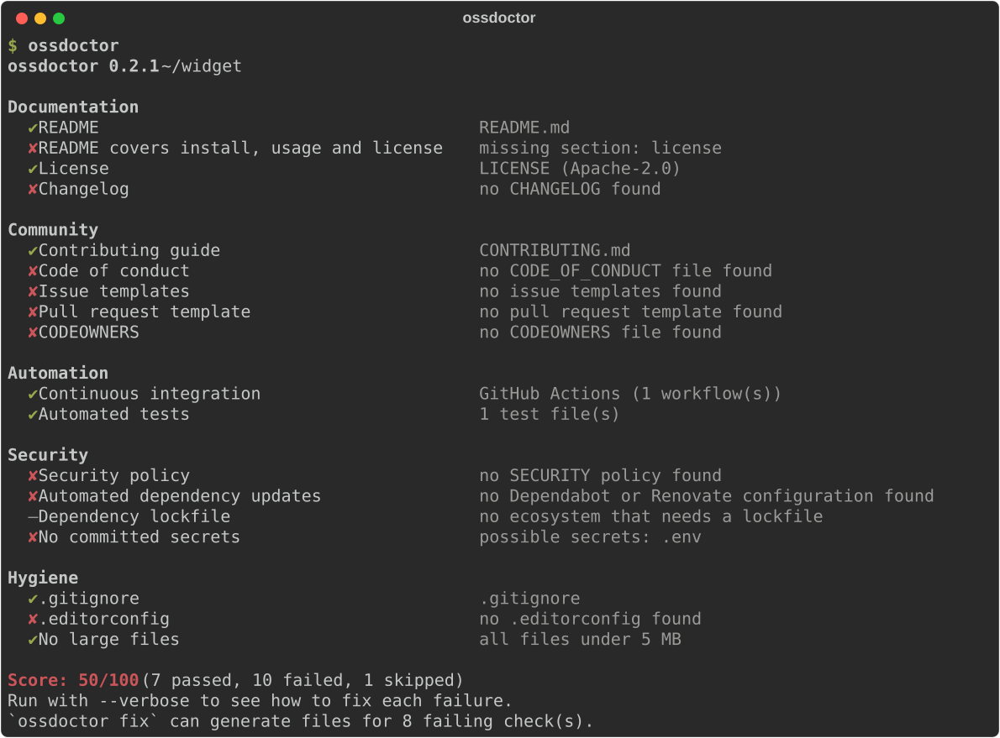

# ossdoctor

[English](README.md)

**开源仓库的"体检"工具。** ossdoctor 检查维护者需要的文档、社区文件和自动化配置，
给仓库打出 0–100 分，并能自动生成缺失的文件。

- **快速、离线**：只读取工作区文件，不调用任何 API，不需要 token。
- **不只报问题，还能修**：`ossdoctor fix` 根据检测到的技术栈生成 LICENSE、
  贡献指南、安全策略、Issue 表单、Dependabot 配置等，绝不覆盖已有文件。
- **适合 CI**：支持 Markdown（用于 Job Summary）、JSON 输出和 `--fail-under` 分数门槛。
- **零依赖**：只用 Python 标准库。

<p align="center">
  
</p>

## 安装

```sh
pipx install ossdoctor      # 或者 pip install ossdoctor
```

需要 Python 3.11 及以上。

## 使用

```sh
ossdoctor                       # 检查当前目录
ossdoctor path/to/repo -v       # 显示每个失败项的修复建议
ossdoctor --format markdown     # 输出 Markdown 表格
ossdoctor --format json         # 输出 JSON
ossdoctor --fail-under 80       # 分数低于 80 时以状态码 1 退出

ossdoctor fix --dry-run         # 预览会生成哪些文件
ossdoctor fix --license MIT --email you@example.com --github-user 你的用户名

ossdoctor list                  # 列出所有检查项
```

生成的文件只是起点，提交前请检查并补充项目相关的内容。

### GitHub Action

```yaml
- uses: actions/checkout@v7
- uses: jalensuggs77/ossdoctor@v0.1.0
  with:
    fail-under: "80"
```

## 配置

在 `pyproject.toml` 中添加 `[tool.ossdoctor]`，或创建 `.ossdoctor.toml`：

```toml
[tool.ossdoctor]
disable = ["codeowners"]
fail-under = 80
large-file-mb = 10
ignore-paths = ["tests/fixtures/*"]
```

完整的检查项列表、评分规则和路线图见 [英文 README](README.md)。

## 参与贡献

欢迎提交 Issue 和 PR，详见 [CONTRIBUTING.md](CONTRIBUTING.md)。

## 许可证

[MIT](LICENSE)
